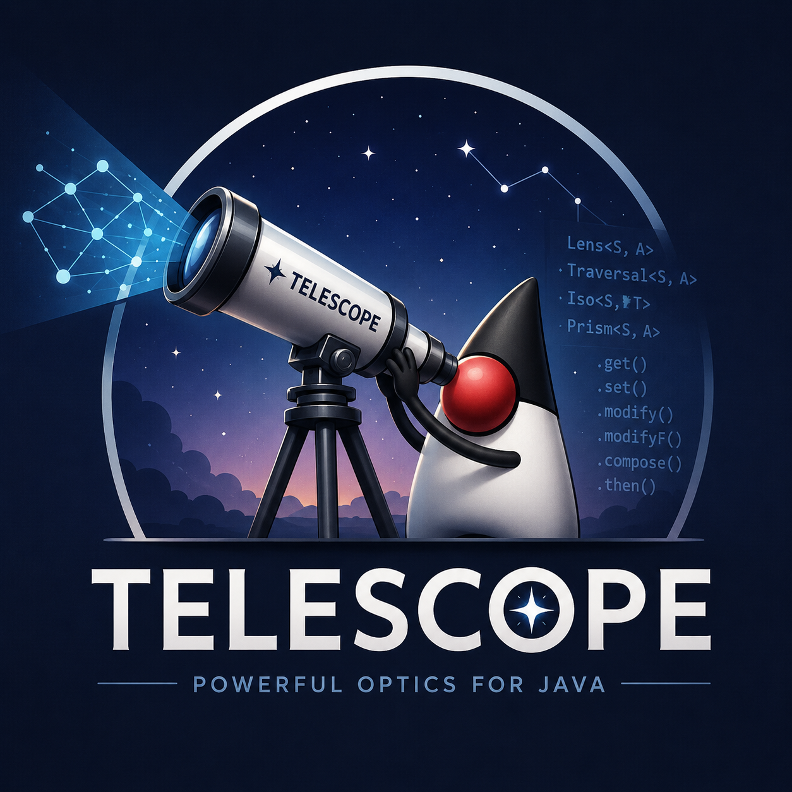

<p align="center">
  
</p>

# telescope

[](https://openjdk.org/projects/jdk/21/)
[](https://github.com/eschizoid/telescope/actions/workflows/ci.yaml)
[](https://codecov.io/gh/eschizoid/telescope)
[](https://central.sonatype.com/artifact/io.github.eschizoid/telescope-core)
[](https://javadoc.io/doc/io.github.eschizoid/telescope-core)
[](https://opensource.org/licenses/Apache-2.0)

Telescope maps and updates Java records and POJOs with method references instead of strings. You write a mapper as an
ordinary Java expression, the compiler checks every field it names, and an annotation processor turns it into plain Java
that runs as fast as code you would write by hand.

```java
public record Invoice(String id, Customer customer, long totalCents, String internalNote) {
  @Bridge
  static final ForwardMapper<Invoice, InvoiceDto> DTO = mapperForward(
    Invoice.class,
    InvoiceDto.class,
    // a renamed field
    to(Invoice::id, InvoiceDto::number),
    // a field read through a nested object
    to(path(Invoice::customer, Customer::email), InvoiceDto::billTo),
    // a field built from the whole invoice
    compute(InvoiceDto::total, Money::format),
    // a field left out on purpose
    drop(Invoice::internalNote)
  );

  public InvoiceDto toDto() {
    return DTO.forward(this);
  }
}

InvoiceDto dto = invoice.toDto();
```

Every field in that mapper is a method reference, so a typo is a compile error and an IDE rename updates the mapper
along with everything else. Fields with the same name on both sides map without a row, nested records included. The
`telescope-codegen` processor reads the expression and generates the conversion, which calls `id()`,
`customer().email()` and `Money.format(invoice)` directly, with no reflection. Leave the processor off the build and the
same field runs the same rows at run time instead, with the same result.

---

## Mapping, one row at a time

You name only what differs between the two types. Each kind of difference has one row.

| What differs                                | Row                                                         |
| ------------------------------------------- | ----------------------------------------------------------- |
| a field has another name                    | `to(Order::customerName, OrderDto::fullName)`               |
| a field has another type                    | `to(Order::placedAt, OrderDto::placedOn, IsoDate.class)`    |
| a field lives inside a nested object        | `to(path(Order::customer, Customer::city), OrderDto::city)` |
| a field is built from the source            | `compute(OrderDto::label, Labels::of)`                      |
| a field gets a fresh value on each call     | `compute(OrderDto::createdAt, Instant::now)`                |
| a field is the same literal every time      | `constant(OrderDto::tenant, "production")`                  |
| a field falls back to a default             | `toOrElse(Order::region, OrderDto::region, "EMEA")`         |
| a field converts through a mapper you wrote | `via(Order::lines, OrderDto::lines, LineMapper.class)`      |
| a source field is left out                  | `drop(Order::internalNote)`                                 |

`IsoDate` is a class implementing `BridgeFn<LocalDate, String>`, `Labels.of(Order)` is any static method taking the
source, and `LineMapper` is a hand-written class with `forward` and `backward` methods. A nested path also works as a
target, so `to(Order::city, path(OrderDto::shipping, Shipping::city))` builds the `shipping` object it writes into.

`Telescope.mapper(...)` returns a two-way `Mapper` with `forward`, `backward` and `patch`. Its rows run in reverse on
`backward`, and it refuses, when it is built, any field it can't map in both directions. `Telescope.mapperForward(...)`
returns a one-way `ForwardMapper`, which leaves a target field it can't fill at its null value. Both take the same rows.

```java
Mapper<Company, CompanyDto> dtoMapper = Telescope.mapper(
  Company.class,
  CompanyDto.class,
  to(User::name, UserDto::fullName), // a rename, applied wherever User and UserDto meet in the tree
  to(Address::city, AddressDto::town),
  to(Address::zip, AddressDto::postalCode)
);

CompanyDto dto = dtoMapper.forward(company);

Company back = dtoMapper.backward(dto); // the same rows, run in reverse
```

A mapper is a value you can hold, pass around and ask questions of. `dtoMapper.explain()` prints every field it maps,
converts or skips, and whether it runs generated code or the runtime engine. `dtoMapper.trace(company)` shows the same
for one input, with its values. [docs/introspection.md](docs/introspection.md) covers both.

## Typed paths

A mapper is built from paths, and a path works on its own too. A path points at data anywhere inside a nested structure,
and you can read through it, count through it, or rebuild the whole structure with one change, without mutating
anything.

```java
static final Telescope<Company, String> EMAILS = Telescope.of(Company.class)
  .each(Company::departments)
  .each(Department::teams)
  .each(Team::users)
  .field(User::email);

Company lowered = EMAILS.update(company, String::toLowerCase); // a new Company, every email lowercased

List<String> all = EMAILS.toList(company);

int howMany = EMAILS.count(company);
```

Without telescope, the same update is about 25 lines of nested `stream().map(...)` calls and constructors that pass
every untouched field through by hand. Several edits on the same structure fold into one pass:

```java
Telescope<Company, Company> normalize = Telescope.all(
  over(EMAILS, String::toLowerCase),
  over(Telescope.of(Company.class).field(Company::name), String::strip)
);

Company cleaned = normalize.apply(company);
```

Paths also go through `Optional`, `Map` values and sealed interfaces, and run an update inside a `CompletableFuture`,
`Optional`, `Either` or `Validated` result. [docs/navigation.md](docs/navigation.md) and
[docs/effects.md](docs/effects.md) have the details.

## One mapper, two ways to run it

The same mapper runs two ways, and the call site is the same either way.

- **Generated.** With `telescope-codegen` on the annotation processor path, `@Bridge` on a `static final` mapper field
  makes the processor compile the field's rows into Java. The field then runs that code.
- **At run time.** Without the processor, or without `@Bridge`, the field builds the mapper from its rows when the class
  loads. Nothing is generated and no build step is needed.

You can start with the runtime mapper and add `@Bridge` where a hot loop needs the speed. A test suite runs the same
inputs through both and fails when they give different results, and a compile-time verifier reports a mapper the runtime
would refuse before the program runs.
[docs/mapstruct-comparison.md](docs/mapstruct-comparison.md#runtime-and-generated-mappers-are-tested-to-give-the-same-result)
explains how the two are held together and the few shapes one refuses and the other accepts.

## Measured performance

<!-- metrics: from MapStructComparisonBenchmark, Actions run 41877328599 -->

On the latest run, a generated mapper took between 0.88 and 1.02 times MapStruct's time on every shape, and allocated
the same bytes per call or fewer. The runtime mapper, which needs no build step, took 1.15 to 3.0 times MapStruct's
time: a fixed cost of 6 to 7 ns per call dominates small objects and fades as the work per call grows.

| Shape                             | MapStruct | telescope, generated | telescope, runtime | bytes per call, all three |
| --------------------------------- | --------: | -------------------: | -----------------: | ------------------------- |
| flat, 5 fields, forward           |   3.31 ns |      3.37 ns (1.02×) |     10.0 ns (3.0×) | 32                        |
| flat, backward                    |   3.42 ns |      3.35 ns (0.98×) |     9.13 ns (2.7×) | 32                        |
| one nested record, forward        |   4.76 ns |      4.77 ns (1.00×) |     11.4 ns (2.4×) | 48                        |
| one nested record, backward       |   5.50 ns |      4.82 ns (0.88×) |     9.95 ns (1.8×) | 48                        |
| three levels with lists, forward  |   61.8 ns |      62.3 ns (1.01×) |    81.3 ns (1.31×) | 376                       |
| three levels with lists, backward |   67.7 ns |      62.5 ns (0.92×) |    78.0 ns (1.15×) | 376                       |
| a 100-entry `Set` field, forward  |  1,557 ns |     1,542 ns (0.99×) |   1,800 ns (1.16×) | 7,560 to 7,576            |
| a 100-entry `Map` field, forward  |  1,336 ns |     1,267 ns (0.95×) |   1,542 ns (1.15×) | 7,528 to 7,560            |

The flat and nested rows run a `@Bridge` mapper field; the deeper rows run a class-level `@Bridge`, which generates the
same kind of code. The run is GitHub Actions run 41877328599 on `main` at `75867893`, with MapStruct 1.6.3 on JDK 25, 4
forks of 8 measured iterations and the allocation profiler. MapStruct's rows are the control, so each ratio is read
within the one run. MapStruct's Map row varied by ±80 ns across forks, so read that ratio as a near tie.

[docs/perf-mapstruct-comparison.md](docs/perf-mapstruct-comparison.md) has the method, every fork and the earlier runs,
and the [`Benchmarks`](.github/workflows/benchmarks.yaml) GitHub Action reproduces any of it.

## Coming from MapStruct

| MapStruct                                                | telescope                                                   |
| -------------------------------------------------------- | ----------------------------------------------------------- |
| `@Mapping(source = "customerName", target = "fullName")` | `to(Order::customerName, OrderDto::fullName)`               |
| `@Mapping(source = "customer.city", target = "city")`    | `to(path(Order::customer, Customer::city), OrderDto::city)` |
| `@Mapping(target = "tenant", constant = "production")`   | `constant(OrderDto::tenant, "production")`                  |
| `@Mapping(target = "label", expression = "java(...)")`   | `compute(OrderDto::label, Labels::of)`                      |
| `@Mapping(target = "region", defaultValue = "EMEA")`     | `toOrElse(Order::region, OrderDto::region, "EMEA")`         |
| `@Mapping(target = "internalNote", ignore = true)`       | `drop(Order::internalNote)`                                 |
| `@Mapper(uses = LineMapper.class)`                       | `via(Order::lines, OrderDto::lines, LineMapper.class)`      |
| `@InheritInverseConfiguration` on a second method        | `backward(...)` on the same mapper                          |
| `@MappingTarget` to update an existing bean              | `into(existingBean, source)`                                |
| `unmappedTargetPolicy = ReportingPolicy.ERROR`           | the default for `Telescope.mapper(...)`                     |

A MapStruct mapper names its fields in strings inside annotations, because Java annotations only accept constants. Its
processor checks those strings when it compiles, but an IDE rename doesn't update them. Telescope keeps the mapping out
of the annotation, so every field is a method reference the compiler checks. The two tools land in the same performance
class on the generated path.

MapStruct still covers a few cases telescope doesn't, such as `@SubclassMapping` across an open class hierarchy rather
than a sealed one. The [full comparison](docs/mapstruct-comparison.md) and the
[migration guide](docs/mapstruct-migration.md) cover both tools in detail, and
[docs/mapstruct-parity.md](docs/mapstruct-parity.md) lists every MapStruct feature with telescope's equivalent.

---

## Install

```kotlin
// Gradle (Kotlin DSL)
dependencies {
  implementation("io.github.eschizoid:telescope-core:2.0.0")
  annotationProcessor("io.github.eschizoid:telescope-codegen:2.0.0") // optional: generated mappers and navigators
}
```

```xml
<!-- Maven -->
<dependency>
  <groupId>io.github.eschizoid</groupId>
  <artifactId>telescope-core</artifactId>
  <version>2.0.0</version>
</dependency>
```

On Maven, the processor goes in the compiler plugin's `annotationProcessorPaths`. [docs/codegen.md](docs/codegen.md) has
that setup, Lombok on the processor path, and JPMS.

## Quick start

This example is complete, so you can paste it into a `main` and run it.

```java
import io.github.eschizoid.telescope.Telescope;

record Address(String city, String zip) {}

record User(String name, Address address) {}

// 1. Build a typed path once. Telescope values are immutable and thread-safe, so static final suits them.
final var userCity = Telescope.of(User.class).field(User::address).field(Address::city);

// 2. Use the path for reading, updating, and everything else.
final var alice = new User("Alice", new Address("Springfield", "49007"));

String city = userCity.read(alice); // "Springfield"

User shouted = userCity.update(alice, String::toUpperCase); // city becomes "SPRINGFIELD", and alice is untouched
```

POJOs work the same way through `Telescope.ofBean(...)`, which rebuilds a bean through its builder, an all-args
constructor or its setters and never mutates the original. [docs/pojos.md](docs/pojos.md) covers write strategies.

---

## Integrations

- **Spring Boot.** `telescope-spring-boot-starter` collects every `Mapper` bean into a registry you look up by source
  and target class. `@TelescopeMapper` turns an interface into an injectable mapper bean, and `@TelescopeGetMapping`
  lets a controller return a domain object while the client receives its DTO. See the
  [starter guide](spring-boot-starter/README.md).
- **Quarkus.** `telescope-quarkus` adds the same registry as a CDI bean. See the [Quarkus guide](quarkus/README.md).
- **Lombok.** `telescope-lombok` generates typed navigators for `@Data`, `@Value` and `@Builder` classes. See the
  [Lombok guide](lombok/README.md).
- **GraalVM native image.** Runtime mappers, typed paths and generated code all run in a native image. Generated code
  needs no configuration, and the runtime path needs your own types registered as in any GraalVM application. See
  [docs/native-image.md](docs/native-image.md).

## Examples

| Module                                                                         | Shows                                                         |
| ------------------------------------------------------------------------------ | ------------------------------------------------------------- |
| [`examples/library/`](examples/library/)                                       | the DSL on its own, in small demos that each have a `main`    |
| [`examples/springboot/order-jpa/`](examples/springboot/order-jpa/)             | Spring Boot, JPA and Hibernate over one realistic order model |
| [`examples/springboot/product-starter/`](examples/springboot/product-starter/) | the starter finding `Mapper` beans with no wiring             |
| [`examples/springboot/org-chart/`](examples/springboot/org-chart/)             | a model that refers back to itself, mapped without looping    |
| [`examples/springboot/invoicing/`](examples/springboot/invoicing/)             | `@Bridge` mappers generated at compile time on a hot path     |
| [`examples/mapstruct-vs-telescope/`](examples/mapstruct-vs-telescope/)         | the same mappings in both tools, tested side by side          |

## Published artifacts

Everything is on Maven Central under `io.github.eschizoid`.

| Artifact                        | What it is                                                                                                       |
| ------------------------------- | ---------------------------------------------------------------------------------------------------------------- |
| `telescope-core`                | typed paths, runtime mappers and the annotations; the one dependency you always add                              |
| `telescope-codegen`             | the optional annotation processor for `@Bridge`, `@Focus`, `@BeanFocus` and `@FromMap`, plus the mapper verifier |
| `telescope-lombok`              | the processor variant for Lombok `@Data`, `@Value` and `@Builder` classes                                        |
| `telescope-spring-boot-starter` | Spring Boot auto-configuration, the mapper registry and generated mapper beans                                   |
| `telescope-quarkus`             | the mapper registry as a Quarkus CDI bean                                                                        |
| `telescope-internal`            | the engine underneath, which arrives with `telescope-core` and isn't meant to be used directly                   |

## Documentation

| Guide                                                                  | Covers                                                                 |
| ---------------------------------------------------------------------- | ---------------------------------------------------------------------- |
| [docs/navigation.md](docs/navigation.md)                               | every path operation, containers, sealed cases, filters and multi-edit |
| [docs/type-conversion.md](docs/type-conversion.md)                     | mappers, rows and structural conversion                                |
| [docs/pojos.md](docs/pojos.md)                                         | beans, write strategies and mixing beans with records                  |
| [docs/codegen.md](docs/codegen.md)                                     | `@Bridge`, `@Focus`, `@BeanFocus`, `@FromMap`, Lombok and JPMS setup   |
| [docs/introspection.md](docs/introspection.md)                         | `explain()`, `trace()` and logging                                     |
| [docs/effects.md](docs/effects.md)                                     | updates inside async, validated, either and optional results           |
| [docs/native-image.md](docs/native-image.md)                           | what a GraalVM native image needs                                      |
| [docs/mapstruct-comparison.md](docs/mapstruct-comparison.md)           | telescope and MapStruct side by side, in detail                        |
| [docs/mapstruct-migration.md](docs/mapstruct-migration.md)             | moving one mapper at a time, and running both tools together           |
| [docs/mapstruct-parity.md](docs/mapstruct-parity.md)                   | every MapStruct feature and its telescope equivalent                   |
| [docs/perf-mapstruct-comparison.md](docs/perf-mapstruct-comparison.md) | benchmark method, environment and every result                         |

## Constraints

- **Method references, not lambdas.** `.field(User::name)` works and `.field(u -> u.name())` is refused, because a
  lambda carries no field name. `.fieldByName(String)` is the late-bound escape hatch, and its name says so.
- **Exact matching.** Fields pair by exact name, recursively, with no fuzzy matching. Without a row, a field converts
  only between the same type, a primitive and its wrapper, an `Optional` and a nullable value, two records or beans that
  map, two containers whose elements convert, or two enums with the same constant names.
- **Records and JavaBeans-style POJOs.** Records rebuild through the canonical constructor. POJOs rebuild through a
  builder, an all-args constructor or setters, in that order, and `WriteHint.writeBean(...)` picks one.
- **Nulls are uniform.** A null in the middle of a path focuses nothing, and a mapper maps `null` to `null`.
  [docs/navigation.md](docs/navigation.md) has the full table.

## Build and test

```bash
./gradlew build          # every module, the starters and the examples
./gradlew check          # what CI runs: every test suite, the formatting gate and the native-image suites
./gradlew :benchmarks:jmh -Pjmh.includes=MapStructComparisonBenchmark   # the head-to-head numbers
```

Java 21 or later runs telescope. The build uses a newer toolchain, and CI builds every module on JDK 25. The design
decisions are recorded in [docs/adr/](docs/adr/).

## License

Telescope is licensed under Apache 2.0. See [LICENSE](LICENSE).
