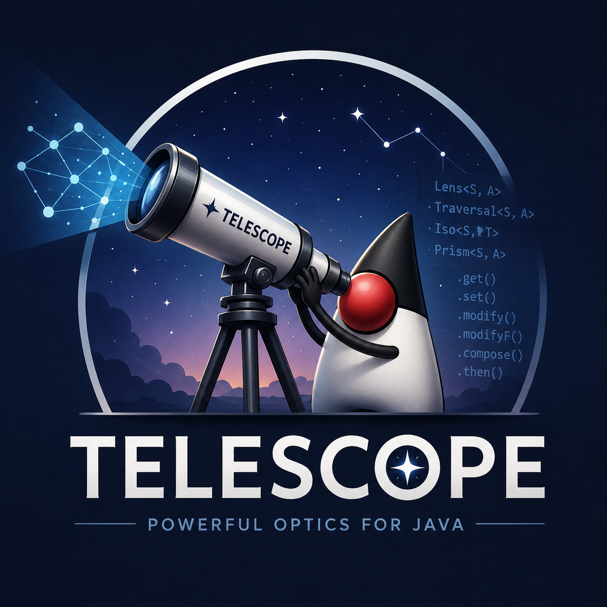

<p align="center">
  
</p>

# telescope

[](https://openjdk.org/projects/jdk/21/)
[](https://github.com/eschizoid/telescope/actions/workflows/ci.yaml)
[](https://codecov.io/gh/eschizoid/telescope)
[](https://central.sonatype.com/artifact/io.github.eschizoid/telescope-core)
[](https://javadoc.io/doc/io.github.eschizoid/telescope-core)
[](https://opensource.org/licenses/Apache-2.0)

**One typed mapping layer for the whole request path: JSON, service and entity.**

Every Java service carries the same data in three shapes: the JSON a REST endpoint reads and writes, the types the
service works with, and the entities it persists. Today each crossing takes a different tool. A JSON library covers the
wire with its own annotations. A mapper generator covers DTOs, with field names written as strings. Nothing covers the
rest, so every team writes it by hand: the PATCH that must change only what the client sent, the entity update that must
not replace a managed collection, the response that must not load a lazy one.

Telescope covers all three crossings with one model. You write each mapping as an ordinary Java expression made of
method references, the compiler checks every field it names, and an annotation processor turns it into plain Java that
runs in the time of hand-written code.

```java
// PATCH /orders/SO-1001   {"delivery":"EXPRESS","lines":[{"sku":"BAG-04","quantity":3}]}

@TelescopePatchMapping(value = "/orders/{number}", to = OrderDto.class) // the client receives an OrderDto
Order change(@PathVariable String number, @RequestBody OrderChanges changes) {
  final var order = orders.get(number); // the entity JPA manages
  EDITS.patchInto(order, changes); // writes only the fields the client sent
  return order;
}

@Bridge
static final Mapper<Order, OrderChanges> EDITS = mapper(
  Order.class,
  OrderChanges.class,
  writeBean(Order.class, ADDERS), // lines go through order.addLine(...), which sets the back-reference
  via(Order::getLines, OrderChanges::lines, LineEdits.class), // each new line is priced from the catalog
  drop(Order::getId), // a client may never change these
  drop(Order::getStatus),
  drop(Order::getPayment)
);
```

That is a whole PATCH endpoint. The delivery and the lines change, and the discount code and tags the client left out
keep their values. The `@OneToMany` list the entity holds is refilled in place, so Hibernate keeps tracking it. The
response is the public DTO, built without loading a lazy collection it doesn't show. Every field is a method reference,
so a typo is a compile error, and a field added to `Order` later fails the build until someone decides whether a PATCH
may change it. The `telescope-codegen` processor compiles the mapper into plain Java with no reflection.

## What you stop writing

| Today, by hand or with a second tool                                    | With telescope                                                                |
| ----------------------------------------------------------------------- | ----------------------------------------------------------------------------- |
| a PATCH handler full of `if (x != null) entity.setX(x)`                 | `EDITS.patchInto(entity, changes)`                                            |
| clearing and refilling a `@OneToMany` list, setting each back-reference | the same call, through the entity's own `addLine`                             |
| a `LazyInitializationException` when a mapper touches a lazy collection | an unloaded collection is never read                                          |
| a controller that converts every return value to a DTO                  | `@TelescopeGetMapping(to = OrderDto.class)` on a handler returning the entity |
| field names as strings in mapper annotations                            | method references the compiler checks and the IDE renames                     |
| a reflective mapper for convenience, a generated one for speed          | one mapper that runs both ways, tested to give the same result                |

## One request, three hops

A client changes an order that has not been paid. The body names only what changes: the delivery, and a new list of
lines.

```bash
curl -X PATCH localhost:8080/orders/SO-1001 -H 'Content-Type: application/json' \
  -d '{"delivery":"EXPRESS","lines":[{"sku":"BAG-04","quantity":3}]}'
```

The request crosses the REST layer, the service and the entity, and the response crosses them again on the way out.
Telescope does the mapping at each crossing, and the handler and the service hold no conversion code.

### In: the handler takes the type the service works with

The body is read into `OrderChanges`, a record whose fields are all optional, so a field the client left out arrives as
null. The handler returns the entity, and the annotation names the type the client receives.

```java
@TelescopePatchMapping(value = "/orders/{number}", to = OrderDto.class)
Order change(@PathVariable String number, @RequestBody OrderChanges changes) {
  return orders.change(number, changes);
}
```

When the wire type differs from the type the service works with, `@TelescopeRequestBody(from = PlaceOrderV2.class)`
reads and validates the body as the wire type and maps it before the handler runs. When JSON comes from outside and has
to be checked strictly, `@FromJson` generates a binder that reads the text straight into a record and refuses a wrong
value by its path and position, as in `'lines[0].quantity' got 2, not a String, at line 1, column 74`.

### Through: the service changes the managed entity in place

The `EDITS` mapper at the top says how an `Order` and an `OrderChanges` relate, and which fields a PATCH may never
touch. The service checks its rules and makes one call.

```java
public Order change(String number, OrderChanges changes) {
  final var order = get(number);
  require(order, OrderStatus.PLACED, "change");
  OrderMappers.EDITS.patchInto(order, changes);
  return orders.save(order);
}
```

That one `patchInto` call stands in for the code every service writes by hand:

```java
if (changes.delivery() != null) order.setDelivery(changes.delivery());
if (changes.discountCode() != null) order.setDiscountCode(changes.discountCode());
if (changes.giftWrap() != null) order.setGiftWrap(changes.giftWrap());
if (changes.lines() != null) {
  order.getLines().clear(); // never setLines(...): Hibernate tracks this list
  for (final var item : changes.lines()) order.addLine(LineEdits.backward(item));
}
// and one more branch for each field anyone adds later, if they remember
```

`patchInto` writes only the fields the client sent into the `Order` the persistence context manages. A field left out
keeps the entity's value. The new lines go through `order.addLine(...)` into the `@OneToMany` list the entity already
holds, so the list keeps its identity, Hibernate deletes the old rows, and each new line gets its back-reference. A
field added to `Order` later fails the build until someone decides whether a PATCH may change it.

With `telescope-jpa` on the classpath, mapping an entity never loads a lazy collection and never throws
`LazyInitializationException` for one, and a lazy Hibernate proxy is read as the entity it stands for. Both starters
bring it.

### Out: the entity leaves as the public DTO

The entity holds what the shop paid for each item, the card token and the warehouse's notes. The public DTO shows none
of them, takes the customer's name from another entity, and carries a total that no column stores.

```java
@Bridge
public static final ForwardMapper<Order, OrderDto> DTO = mapperForward(
  Order.class,
  OrderDto.class,
  to(path(Order::getCustomer, Customer::getName), OrderDto::customerName),
  compute(OrderDto::total, Pricing::total),
  drop(Order::getInternalNotes)
);
```

The starter maps the entity the handler returned where Spring MVC writes the body, and the client receives the new
lines, the recomputed total, and the discount code and tags the order kept.

```text
{"number":"SO-1001","delivery":"EXPRESS","lines":[{"sku":"BAG-04","name":"Tote bag","quantity":3,"unitPrice":15.00}],
 "total":40.50,"discountCode":"WELCOME10","tags":["gift"], ...}
```

The code comes from [`examples/demo/`](examples/demo/README.md), an order service that runs on Spring Boot, on Quarkus
and as a GraalVM native image from the same mappers. Its README walks the rest of the service the same way: an older API
version the mobile app still calls, a partner feed where every value is text, and an invoice built from several objects.

| Hop                       | What telescope does there                                                                       | Guide                                                                                                                      |
| ------------------------- | ----------------------------------------------------------------------------------------------- | -------------------------------------------------------------------------------------------------------------------------- |
| REST endpoint and service | maps response and request bodies, binds JSON to a type, registers mappers as Jackson converters | [Spring Boot starter](spring-boot-starter/README.md), [Quarkus](quarkus/README.md), [telescope-jackson](jackson/README.md) |
| Inside the service        | typed rows on a mapper field, run as `forward`, `backward`, `patch` or `into`                   | [docs/type-conversion.md](docs/type-conversion.md), [docs/codegen.md](docs/codegen.md)                                     |
| Service and entity        | `into` and `patchInto` update a managed entity in place, without loading what is lazy           | [docs/pojos.md](docs/pojos.md), [telescope-jpa](jpa/README.md)                                                             |

## A mapper names only what differs

A mapper is a `static final` field on any class, often the type it converts.

```java
public record Invoice(String id, Customer customer, long totalCents, String internalNote) {
  @Bridge
  static final ForwardMapper<Invoice, InvoiceDto> DTO = mapperForward(
    Invoice.class,
    InvoiceDto.class,
    // a renamed field
    to(Invoice::id, InvoiceDto::number),
    // a field read through a nested object
    to(path(Invoice::customer, Customer::email), InvoiceDto::billTo),
    // a field built from the whole invoice
    compute(InvoiceDto::total, Money::format),
    // a field left out on purpose
    drop(Invoice::internalNote)
  );

  public InvoiceDto toDto() {
    return DTO.forward(this);
  }
}

InvoiceDto dto = invoice.toDto();
```

Fields with the same name on both sides map without a row, nested records included. The generated conversion calls
`id()`, `customer().email()` and `Money.format(invoice)` directly. Leave the processor off the build and the same field
runs the same rows at run time instead, with the same result.

Each kind of difference between the two types has one row.

| What differs                                | Row                                                              |
| ------------------------------------------- | ---------------------------------------------------------------- |
| a field has another name                    | `to(Order::customerName, OrderDto::fullName)`                    |
| a field has another type                    | `to(Order::placedAt, OrderDto::placedOn, IsoDate.class)`         |
| a field lives inside a nested object        | `to(path(Order::customer, Customer::city), OrderDto::city)`      |
| a field is built from the source            | `compute(OrderDto::label, Labels::of)`                           |
| a field is the same literal every time      | `constant(OrderDto::tenant, "production")`                       |
| a field falls back to a default             | `toOrElse(Order::region, OrderDto::region, "EMEA")`              |
| a date or number is written as text         | `toFormatted(Order::shipDate, OrderDto::shipDate, "dd.MM.yyyy")` |
| a field converts through a mapper you wrote | `via(Order::lines, OrderDto::lines, LineMapper.class)`           |
| a source field is left out                  | `drop(Order::internalNote)`                                      |

`Telescope.mapper(...)` returns a two-way `Mapper`. It runs its rows in reverse on `backward`, and it refuses, when it
is built, a field on either side that no row and no same-named field accounts for. `Telescope.mapperForward(...)`
returns a one-way `ForwardMapper`, which leaves a target field it can't fill at its null value. Both take the same rows.

| Call                           | What it does                                                    |
| ------------------------------ | --------------------------------------------------------------- |
| `forward(source)`              | builds the target from the source                               |
| `backward(target)`             | builds the source from the target, the same rows run in reverse |
| `patch(base, partial)`         | returns a new object with only the fields the partial sets      |
| `into(existing, source)`       | writes the source into an object you already hold               |
| `patchInto(existing, partial)` | writes into it only the fields the partial sets                 |

A mapper is a value you can hold, pass around and ask questions of. `explain()` lists the fields it pairs, converts or
skips, and `trace(input)` shows the same for one input, with its values.
[docs/type-conversion.md](docs/type-conversion.md) covers every row and [docs/introspection.md](docs/introspection.md)
covers both questions.

## Generated or at run time

The same mapper field runs two ways, and the call site is the same either way.

- **Generated.** With `telescope-codegen` on the annotation processor path, `@Bridge` on a `static final` mapper field
  makes the processor compile the field's rows into plain Java. The field then runs that code.
- **At run time.** Without the processor, or without `@Bridge`, the field builds the mapper from its rows when the class
  loads. Nothing is generated and no build step is needed.

You can start with the runtime mapper and add `@Bridge` where a hot loop needs the speed. A test suite runs the same
inputs through both and fails when they give different results, and a compile-time verifier reports at build time what
the runtime mapper would refuse.

The processor also writes a `<Type>Mappings` interface for each type a `@Bridge` field converts, so a type that
implements it converts itself:

```java
public record Order(Long id, String customer) implements OrderMappings {
  @Bridge
  static final Mapper<Order, OrderDto> DTO = mapper(Order.class, OrderDto.class, to(Order::id, OrderDto::number));
}

OrderDto dto = order.toOrderDto(); // Order.DTO.forward(order)
```

[docs/codegen.md](docs/codegen.md) has the rules.

## Performance

A generated mapper runs in MapStruct's time and allocates what MapStruct allocates. The runtime mapper, which needs no
build step, adds a few nanoseconds per call.

| Shape                             | MapStruct | telescope, generated | telescope, runtime |
| --------------------------------- | --------: | -------------------: | -----------------: |
| flat, 5 fields, forward           |   4.56 ns |      4.58 ns (1.00×) |     8.16 ns (1.8×) |
| one nested record, forward        |   6.99 ns |      7.03 ns (1.01×) |     9.35 ns (1.3×) |
| three levels with lists, forward  |   53.6 ns |      50.4 ns (0.94×) |    64.3 ns (1.20×) |
| three levels with lists, backward |   56.6 ns |      49.9 ns (0.88×) |    63.4 ns (1.12×) |
| a 100-entry `Set` field, forward  |  1,213 ns |     1,197 ns (0.99×) |   1,293 ns (1.07×) |
| a 100-entry `Map` field, forward  |  1,251 ns |     1,271 ns (1.02×) |   1,343 ns (1.07×) |

The figures are JMH results from CI against MapStruct 1.6.3 on JDK 25.
[docs/perf-mapstruct-comparison.md](docs/perf-mapstruct-comparison.md) has the method, every run and its controls, and
the [`Benchmarks`](.github/workflows/benchmarks.yaml) workflow reproduces them.

## Coming from MapStruct

| MapStruct                                                  | telescope                                                        |
| ---------------------------------------------------------- | ---------------------------------------------------------------- |
| `@Mapping(source = "customerName", target = "fullName")`   | `to(Order::customerName, OrderDto::fullName)`                    |
| `@Mapping(source = "customer.city", target = "city")`      | `to(path(Order::customer, Customer::city), OrderDto::city)`      |
| `@Mapping(target = "tenant", constant = "production")`     | `constant(OrderDto::tenant, "production")`                       |
| `@Mapping(target = "label", expression = "java(...)")`     | `compute(OrderDto::label, Labels::of)`                           |
| `@Mapping(target = "region", defaultValue = "EMEA")`       | `toOrElse(Order::region, OrderDto::region, "EMEA")`              |
| `@Mapping(target = "shipDate", dateFormat = "dd.MM.yyyy")` | `toFormatted(Order::shipDate, OrderDto::shipDate, "dd.MM.yyyy")` |
| `@Mapping(target = "total", numberFormat = "$#.00")`       | `toFormattedNumber(Order::total, OrderDto::total, "$#.00")`      |
| `@Mapping(target = "internalNote", ignore = true)`         | `drop(Order::internalNote)`                                      |
| `@Mapper(uses = LineMapper.class)`                         | `via(Order::lines, OrderDto::lines, LineMapper.class)`           |
| `@InheritInverseConfiguration` on a second method          | `backward(...)` on the same mapper                               |
| `@MappingTarget` to update an existing bean                | `into(existingBean, source)`                                     |
| `unmappedTargetPolicy = ReportingPolicy.ERROR`             | the default for `Telescope.mapper(...)`                          |

A MapStruct mapper names its fields in strings inside annotations, because Java annotations only accept constants. Its
processor checks those strings when it compiles, but a plain IDE rename doesn't update them. Telescope keeps the mapping
out of the annotation, so every field is a method reference the compiler checks.

MapStruct still covers a few cases telescope doesn't, such as `@SubclassMapping` across an open class hierarchy rather
than a sealed one. The [full comparison](docs/mapstruct-comparison.md) and the
[migration guide](docs/mapstruct-migration.md) cover both tools in detail, and
[docs/mapstruct-parity.md](docs/mapstruct-parity.md) scores every MapStruct feature against telescope's equivalent.

## Install

```kotlin
// Gradle (Kotlin DSL)
dependencies {
  implementation("io.github.eschizoid:telescope-core:2.2.0")
  annotationProcessor("io.github.eschizoid:telescope-codegen:2.2.0") // optional: generated mappers
}
```

```xml
<!-- Maven -->
<dependency>
  <groupId>io.github.eschizoid</groupId>
  <artifactId>telescope-core</artifactId>
  <version>2.2.0</version>
</dependency>
```

On Maven, the processor goes in the compiler plugin's `annotationProcessorPaths`; [docs/codegen.md](docs/codegen.md) has
that setup. Everything is on Maven Central under `io.github.eschizoid`, and you add a module for each layer you want
telescope to reach.

| Artifact                        | Add it for                                                                                   | Guide                                  |
| ------------------------------- | -------------------------------------------------------------------------------------------- | -------------------------------------- |
| `telescope-core`                | mappers, typed paths and the annotations; the one dependency you always add                  | [docs/](docs/type-conversion.md)       |
| `telescope-codegen`             | the annotation processor behind `@Bridge`, `@FromJson`, `@FromMap` and the mapper verifier   | [docs/codegen.md](docs/codegen.md)     |
| `telescope-spring-boot-starter` | mapped responses and request bodies on Spring MVC, a mapper registry, generated mapper beans | [guide](spring-boot-starter/README.md) |
| `telescope-quarkus`             | the mapper registry and generated mapper beans on Quarkus                                    | [guide](quarkus/README.md)             |
| `telescope-jackson`             | JSON read straight into a type, and mappers as Jackson 3 converters                          | [guide](jackson/README.md)             |
| `telescope-jpa`                 | lazy collections and proxies on JPA entities; both starters bring it                         | [guide](jpa/README.md)                 |
| `telescope-lombok`              | typed navigators for Lombok `@Data`, `@Value` and `@Builder` classes                         | [guide](lombok/README.md)              |

`telescope-jackson`, `telescope-jpa`, `patchInto` and `@FromJson` arrive with the release after 2.2.0. Everything runs
in a GraalVM native image, and generated mappers and binders need no reflection configuration there;
[docs/native-image.md](docs/native-image.md) has the details.

## Typed paths, the part underneath

A mapper is built from paths, and a path works on its own too. A path points at data anywhere inside a nested structure.
You can read through it, or rebuild the whole structure with one change, without mutating anything.

```java
static final Telescope<Company, String> EMAILS = Telescope.of(Company.class)
  .each(Company::departments)
  .each(Department::teams)
  .each(Team::users)
  .field(User::email);

Company lowered = EMAILS.update(company, String::toLowerCase); // a new Company, every email lowercased

List<String> all = EMAILS.toList(company);
```

Without telescope, the same update rebuilds every record on the way down, with nested `stream().map(...)` calls and
constructors that pass every untouched field through by hand. Several edits on the same structure fold into one pass:

```java
Telescope<Company, Company> normalize = Telescope.all(
  over(EMAILS, String::toLowerCase),
  over(Telescope.of(Company.class).field(Company::name), String::strip)
);

Company cleaned = normalize.apply(company);
```

Paths also go through `Optional`, `Map` values and sealed interfaces, work on POJOs through `Telescope.ofBean(...)`, and
run an update inside a `CompletableFuture`, `Optional`, `Either` or `Validated` result.
[docs/navigation.md](docs/navigation.md) and [docs/effects.md](docs/effects.md) have the details.

## Documentation

| Layer                     | Guide                                                                  | Covers                                                                 |
| ------------------------- | ---------------------------------------------------------------------- | ---------------------------------------------------------------------- |
| REST endpoint and service | [spring-boot-starter/README.md](spring-boot-starter/README.md)         | mapped responses and request bodies, springdoc, the registry and beans |
|                           | [quarkus/README.md](quarkus/README.md)                                 | the mapper registry and generated beans on Quarkus                     |
|                           | [jackson/README.md](jackson/README.md)                                 | JSON straight into a type, `@FromJson`, mappers as Jackson converters  |
| Inside the service        | [docs/type-conversion.md](docs/type-conversion.md)                     | mappers, rows and structural conversion                                |
|                           | [docs/codegen.md](docs/codegen.md)                                     | `@Bridge`, `<Type>Mappings`, `@FromMap`, navigators, Lombok and JPMS   |
|                           | [docs/introspection.md](docs/introspection.md)                         | `explain()`, `trace()` and logging                                     |
|                           | [docs/navigation.md](docs/navigation.md)                               | every path operation, containers, sealed cases, filters and multi-edit |
|                           | [docs/effects.md](docs/effects.md)                                     | updates inside async, validated, either and optional results           |
| Service and entity        | [docs/pojos.md](docs/pojos.md)                                         | beans, write strategies, `into` and `ADDERS`                           |
|                           | [jpa/README.md](jpa/README.md)                                         | lazy collections and proxies on JPA entities                           |
| Coming from MapStruct     | [docs/mapstruct-comparison.md](docs/mapstruct-comparison.md)           | the two tools side by side                                             |
|                           | [docs/mapstruct-migration.md](docs/mapstruct-migration.md)             | moving one mapper at a time, and running both together                 |
|                           | [docs/mapstruct-parity.md](docs/mapstruct-parity.md)                   | every MapStruct feature and its telescope equivalent                   |
| Running it                | [docs/perf-mapstruct-comparison.md](docs/perf-mapstruct-comparison.md) | benchmark method, environment and every result                         |
|                           | [docs/native-image.md](docs/native-image.md)                           | what a GraalVM native image needs                                      |

The design decisions are recorded in [docs/adr/](docs/adr/).

## Constraints

- **Method references, not lambdas.** `.field(User::name)` works and `.field(u -> u.name())` is refused, because a
  lambda carries no field name. `.fieldByName(String)` is the late-bound escape hatch, and its name says so.
- **Exact matching.** Fields pair by exact name, with no fuzzy matching. Without a row, a field converts between types
  that hold the same value: a primitive and its wrapper, an `Optional` and a nullable value, nested records or beans,
  containers whose elements convert, enums with the same constant names, and a `String` against a number, an enum or a
  boolean. Narrowing, and text against a date or time, take a row.
- **Records and JavaBeans-style POJOs.** Records rebuild through the canonical constructor. POJOs rebuild through a
  builder, an all-args constructor or setters, in that order, and `WriteHint.writeBean(...)` picks one.
- **Nulls are uniform.** A null in the middle of a path focuses nothing, and a mapper maps `null` to `null`.

## Build and test

```bash
./gradlew build   # every module, the starters and the examples
./gradlew check   # what CI runs: every test suite, the formatting gate, and the suites rerun on the native-image code path
```

Telescope's classes target Java 21, and CI builds every module on JDK 25.

## License

Telescope is licensed under Apache 2.0. See [LICENSE](LICENSE).
